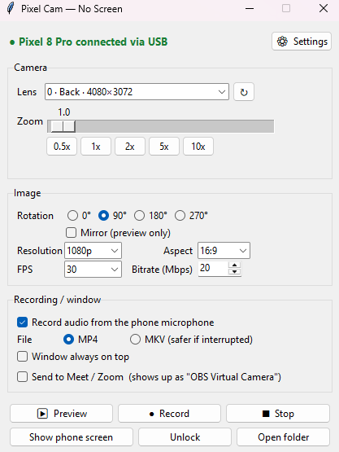

# Pixel Cam — No Screen

**Use an Android phone with a broken screen as a high-quality camera on Windows — over USB, without touching the phone.**

[Español](README.es.md) · [Broken-screen rescue guide](docs/rescue-guide.md)

<p align="center"></p>

Pixel Cam is a small Windows app built on top of [scrcpy](https://github.com/Genymobile/scrcpy). It was born to rescue a Google Pixel 8 Pro whose display died: the phone still works, its cameras are excellent, but you can't see or touch anything on it. Pixel Cam lets you pick the lens, zoom, rotation and quality from your PC, record video, and send the image to Meet, Zoom or any app that accepts a webcam.

## Features

- **Every lens the phone exposes**, detected automatically, including the ultra-wide (zoom below 1x).
- **Zoom, rotation, mirror, resolution (up to 4K), aspect ratio, FPS and bitrate** — changes apply live to the preview.
- **Record video** straight to MP4 or MKV, with audio from the phone's microphone.
- **Send to Meet / Zoom / Teams** as a webcam (through the OBS Virtual Camera driver — OBS itself stays closed).
- **Automatic unlock**: set your PIN once and the app unlocks the phone before each action. The PIN is stored encrypted for your Windows user.
- **Mirror and control the phone screen** from your PC (mouse and keyboard).
- **Keeps the phone screen awake** while it is plugged in, so the camera doesn't stop.
- English and Spanish interface.
- Nothing to install on the phone.

## Requirements

| What | Why |
|---|---|
| Windows 10 or 11 | The app and the virtual camera are Windows-only |
| Python 3.9 or newer | Runs the app ([python.org](https://www.python.org/downloads/)) |
| [scrcpy](https://github.com/Genymobile/scrcpy) | Does the actual camera streaming. Tested with scrcpy 5.0.1. It ships with `adb` |
| Android 12 or newer | Needed by scrcpy to use the phone's camera |
| **USB debugging enabled and this PC authorized** | If your screen is already broken and that is not the case, see the [rescue guide](docs/rescue-guide.md) |
| OBS Studio *(optional)* | Only for "Send to Meet / Zoom": installing it adds the virtual camera driver |

## Installation

1. **Install scrcpy** (it includes `adb`):
   ```powershell
   winget install Genymobile.scrcpy
   ```
2. **Download this project**: *Code → Download ZIP* and unzip it, or
   ```powershell
   git clone https://github.com/stgermanrobert/pixel-cam-noscreen.git
   ```
3. *(Optional, for Meet / Zoom)* install OBS Studio once and the extra Python libraries:
   ```powershell
   winget install OBSProject.OBSStudio
   python -m pip install -r requirements.txt
   ```
4. **Double-click `pixel_cam.pyw`.**

## First use

1. Plug the phone into the PC with a USB cable. The top of the window should say *"● Pixel 8 Pro connected via USB"* (or your model).
2. Open **⚙ Settings**, type your **PIN** and save. From then on the app unlocks the phone by itself. *Test unlock* checks it right away.
3. The app detects the phone's cameras on its own. Pick a lens, press **▶ Preview**, and adjust.

## Usage

| Button | What it does |
|---|---|
| **▶ Preview** | Opens a window with the camera. Changing any setting reopens it automatically with the new settings (1–2 s cut). |
| **● Record** | Records to your *Videos\Pixel Cam* folder (configurable). Works from the preview too. |
| **■ Stop** | Closes the camera and, when recording, saves the file. |
| **Show phone screen** | Mirrors the phone's screen so you can use it with mouse and keyboard. |
| **Unlock** | Unlocks the phone with your saved PIN. |

### Using it in Meet, Zoom or Teams

1. Check **Send to Meet / Zoom**. The preview opens if it wasn't already.
2. In the call, choose **OBS Virtual Camera** as the camera (reload the page if it's not listed).

Tips:
- **Don't minimize** the camera window — the image would freeze. Covering it with other windows is fine.
- The quality the call receives depends on the size of that window: make it at least ~1280 px wide. The virtual camera sends 1280×720.
- If OBS is open with *Start Virtual Camera* running, stop it: the driver only accepts one source.

## How it works

```
Phone camera ──USB──▶ scrcpy (camera window) ──▶ Pixel Cam
                                                  ├─ recording: scrcpy writes MP4/MKV
                                                  └─ "Send to Meet": captures the window ──▶ OBS Virtual Camera driver ──▶ Meet / Zoom
```

- scrcpy can't change camera settings while running, so Pixel Cam restarts it after each change and puts the window back in the same place.
- Locked-screen detection uses a heuristic (`dumpsys window` shows the *NotificationShade* focused while the keyguard is up). Tested on Android 16; other versions may behave differently.

## Settings and privacy

- Settings are stored in `%APPDATA%\pixel-cam-noscreen\config.json`, **never inside the project folder**, so nothing personal ends up in a repository.
- The PIN is encrypted with Windows DPAPI: only your Windows user, on your PC, can decrypt it.
- Unlocking works with **PIN or password**. Pattern locks are not supported.

## Troubleshooting

| Problem | Fix |
|---|---|
| "No phone connected" | Run `adb devices`. If it says `unauthorized`, this PC isn't authorized: see the [rescue guide](docs/rescue-guide.md). |
| "scrcpy not found" / "adb not found" | Install scrcpy with winget, or set the paths in **⚙ Settings**. If you just installed it, sign out and back in to Windows so it shows up in the PATH. |
| "A library is missing" when enabling Meet | The message copies an install command for the exact Python that runs the app. If that Python has no pip: `python.exe -m ensurepip --upgrade` first. |
| The camera window closes on its own | The log box shows scrcpy's exit code and last lines. |
| Still locked after unlocking | Check the PIN in Settings and use *Test unlock*. |
| Lines or a title bar visible in Meet | Open an issue with a screenshot (window-cropping depends on Windows scaling). |

## Limitations

- Windows only.
- The phone must have had **USB debugging** enabled before the screen broke (or you must be able to enable it — see the rescue guide).
- Camera settings can't change mid-recording; they apply to the next recording.
- In recordings, rotation is stored as video metadata (YouTube and normal players respect it) and **mirror is not applied**.

## Credits

- [scrcpy](https://github.com/Genymobile/scrcpy) by Genymobile (Apache 2.0) — does all the heavy lifting.
- [pyvirtualcam](https://github.com/letmaik/pyvirtualcam), [windows-capture](https://github.com/NiiightmareXD/windows-capture), [OpenCV](https://opencv.org/), [NumPy](https://numpy.org/).
- The OBS Virtual Camera driver from [OBS Studio](https://obsproject.com/).

## License

[MIT](LICENSE) © 2026 Germán Robert
